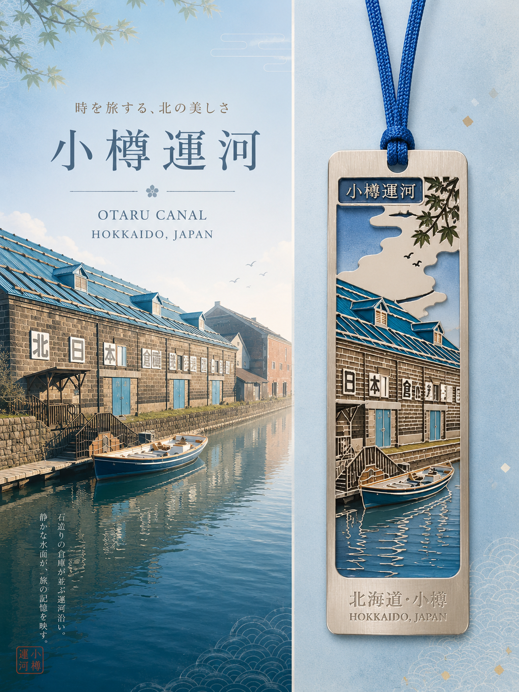
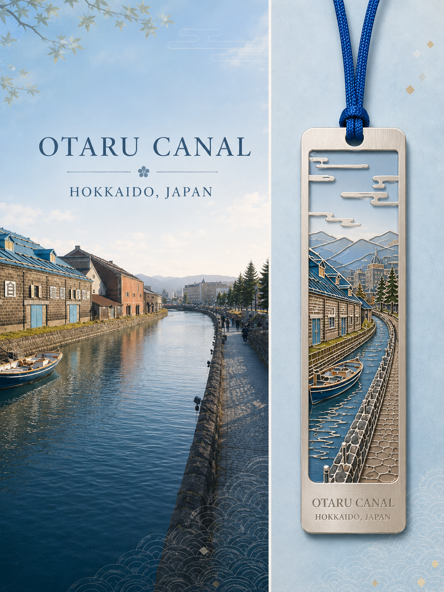
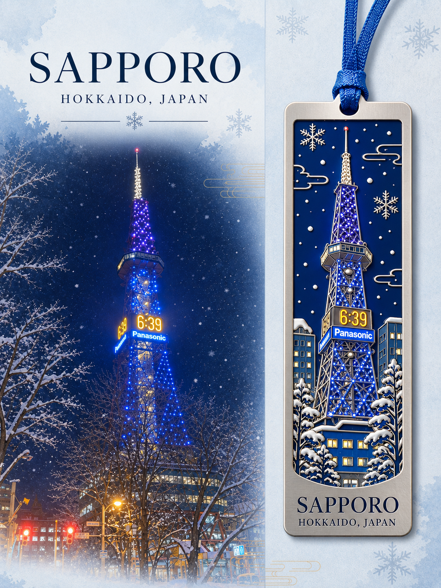
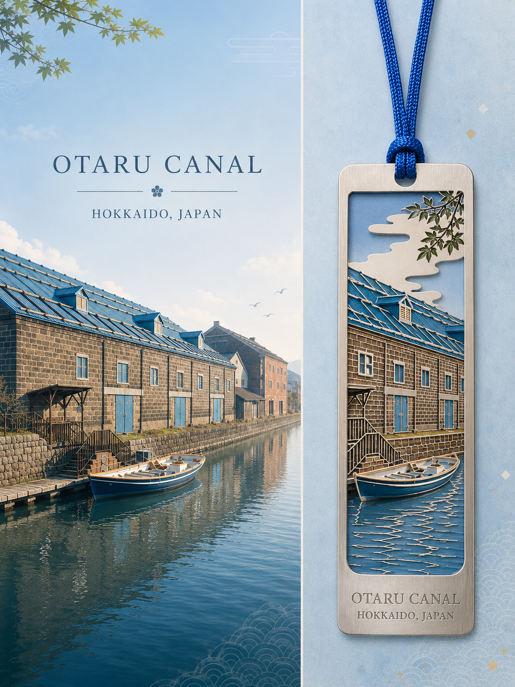
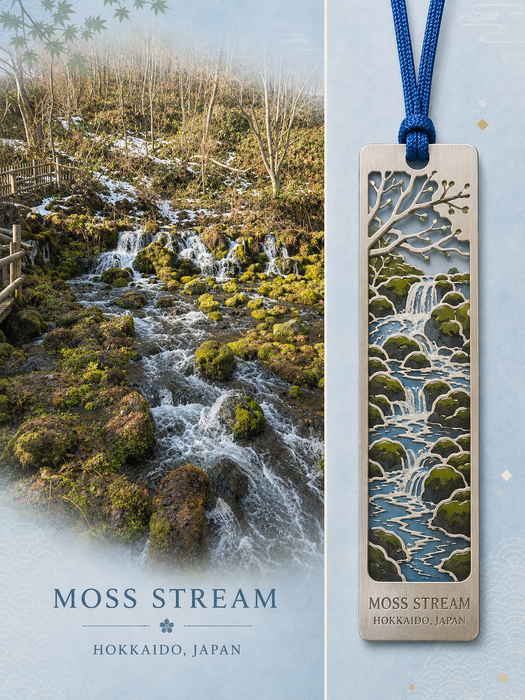
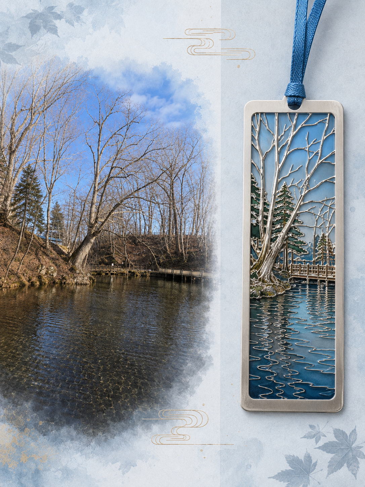

# Scenic Bookmark Travel Poster

Turn a scenic travel photo into a refined Japanese-style souvenir poster with a matching bookmark design.

This skill generates a **3:4 vertical travel poster** with a split composition:

- **Left:** scenic location / original landscape
- **Right:** a newly designed souvenir bookmark inspired by the same place

The result should feel like a **premium Japanese travel collectible** rather than a simple side-by-side collage.

## Core concept

**Scenery → visual extraction → bookmark translation → unified travel poster**

The scenic image provides:
- recognizable landmark features
- dominant and secondary colors
- atmosphere
- local architectural / natural motifs

The generated bookmark converts those features into:
- simplified shapes
- enamel / metal / wood details
- engraved or embossed typography
- a realistic collectible product

## Best use cases

- Travel memory posters
- Destination souvenir concepts
- Tourism campaign visuals
- Social media key visuals
- Collectible bookmark concepts
- Landmark merchandise mockups

## Inputs

### Required
- Scenic / travel image
- Location name in English
- Country or region in English

### Optional
- Bookmark reference image
- Preferred material
- Extra poetic phrase
- Color preference
- Specific landmark feature to preserve

## Default output

- Aspect ratio: **3:4 vertical**
- Layout: **left scenery / right bookmark**
- Style: **Japanese elegant / soft luxury / editorial**
- Background: **pale blue / mist blue**
- Typography: **refined Japanese-inspired editorial hierarchy**

## Key rule

The bookmark must be **designed from the scenery**, not created by directly cropping the photo.

It should look like a real souvenir product that could plausibly be manufactured.

## File structure

```text
scenic-bookmark-travel-poster/
├── README.md
├── SKILL.md
├── prompt.md
├── examples.md
└── assets/
    ├── moss-stream-example.png
    ├── otaru-canal-close-example.png
    ├── otaru-canal-wide-example.png
    ├── otaru-example.png
    ├── sapporo-example.png
    └── woodland-pond-example.png
```

## Gallery

These examples use the same left-scenery / right-bookmark system and show how the skill adapts the bookmark artwork to different landmarks and natural scenes.

| Otaru Canal | Otaru Canal — wide view | Sapporo TV Tower |
| --- | --- | --- |
|  |  |  |

| Otaru Canal — close view | Moss Stream | Woodland Pond |
| --- | --- | --- |
|  |  |  |

## Recommended usage

1. Upload a scenic image.
2. Provide the English location name and country/region.
3. Optionally upload a bookmark reference image.
4. Invoke the skill.
5. Generate one polished 3:4 poster.

See `SKILL.md` for execution rules and `prompt.md` for the reusable generation prompt.
